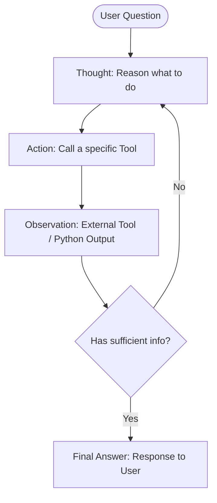

# Day 7: Understanding the ReAct Pattern in AI Engineering

In AI Engineering, **ReAct** stands for:

$$\textbf{ReAct} = \textbf{Reasoning} + \textbf{Acting}$$

It is an agentic framework and prompting pattern introduced by Princeton and Google Research in their 2022 paper (*"ReAct: Synergizing Reasoning and Acting in Language Models"*).

---

## 1. Why do we need ReAct?

Before ReAct, LLMs struggled with complex, multi-step real-world problems:

1. **Reasoning Only (Chain-of-Thought)**:
   - The LLM reasons internally step-by-step.
   - **Limitation**: It cannot access real-time external data (live prices, current weather, database records) and frequently hallucinates facts and math calculations.

2. **Acting Only (Tool Use without Reasoning)**:
   - The LLM directly invokes external tools/APIs.
   - **Limitation**: Without a planning phase, it fails to formulate multi-step plans, uses bad tool parameters, and cannot recover when tools return unexpected results.

**ReAct solves this by combining both into an iterative loop**:
> **Reason** about what to do next $\rightarrow$ **Act** by executing an external tool $\rightarrow$ **Observe** the outcome $\rightarrow$ Repeat until solved.

---

## 2. The Core ReAct Cycle



### The 4 Key Components:
- **`Thought`**: The model's internal reasoning and planning step.
- **`Action`**: The specific tool called with its arguments (e.g., `get_product_price("iPhone 17")`).
- **`Observation`**: The real-world output returned from the environment/tool back into the LLM context.
- **`Final Answer`**: The conclusion delivered to the user once the task is complete.

---

## 3. How It Works in `reAct.py`

In this project, we built a ReAct agent from scratch:

1. **System Prompt**: Instructs the LLM on the strict `Thought -> Action -> Observation` format and gives it the list of available tools.
2. **Tools**:
   - `get_product_price(product)`: Looks up product catalog prices.
   - `calculator(expression)`: Safely computes arithmetic operations.
3. **Execution Loop**:
   - Sends the current conversation history to the model (`openai/gpt-oss-120b`).
   - Uses Regular Expressions (`re.search`) to extract the tool name and arguments.
   - Executes the corresponding Python function.
   - Appends the tool result back into the message history as an `Observation: ...`.
   - Stops when the model produces `Final Answer: ...`.

---

## 4. How to Run

Ensure your `.env` contains your `GROQ_API_KEY`, then run via `uv`:

```powershell
# 1. Install dependencies
uv sync

# 2. Run the agent script
uv run python reAct.py
```

### Example Execution Trace:

```text
------------------
STEP 1
------------------
Action: get_product_price("iPhone 17")
Observation: 1000

------------------
STEP 2
------------------
Action: calculator("5000 - 1000")
Observation: 4000

------------------
STEP 3
------------------
Final Answer: The iPhone 17 costs 1000 rupees. After purchasing it, you will have 4000 rupees left.
```

---

## 5. Significance in the Modern AI Stack

The ReAct pattern forms the underlying foundation for modern autonomous agent frameworks, including:
- **LangChain & LangGraph Agents**
- **OpenAI Assistants API / Function Calling loops**
- **CrewAI & AutoGPT**
- **Coding Agents & Multi-Agent Workflows**
